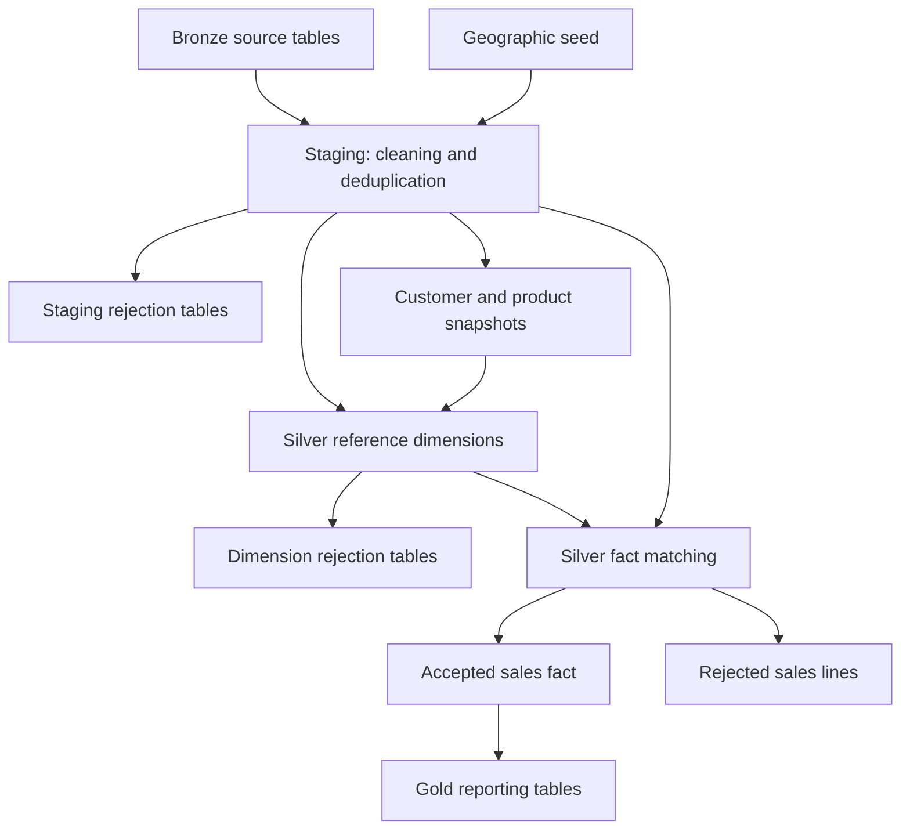

# Sales Analytics with dbt and Snowflake

A Data Engineering portfolio project that transforms sales data already loaded into Snowflake into tested analytical tables with dbt. It combines data cleaning, duplicate handling, dimensional modelling, customer and product history, rejected-record tracking and a reporting layer.

## Validated results

Results verified on the development dataset on **21 October 2026**:

| Measure | Result |
|---|---:|
| Successful dbt build tasks | 73 |
| Data tests included in the build | 28 |
| Accepted Silver sales lines | 382 |
| Rejected Silver sales lines | 86 |
| Gold sales lines | 382 |
| Distinct accepted sales | 343 |
| Accepted units sold | 5,578 |
| Accepted revenue | 1,080,167.5413 |
| Silver calendar dates | 1,826 |

Silver and Gold have matching line counts, distinct sale counts, quantities and revenue. A subsequent build produced unchanged fact row counts. Revenue is shown without a currency symbol because its currency has not been verified.

The **468 accepted-or-rejected fact lines** cover accepted staging detail records with an accepted sale header. This is not a reconciliation of every raw Bronze record. Successful builds and these checks demonstrate consistency on the tested dataset, rather than production readiness.

## Architecture



| Layer | Purpose | Examples |
|---|---|---|
| Bronze sources | Inputs loaded before dbt runs | `customer`, `product`, `sale`, `detail_sale` |
| Staging in Bronze | Cleaned views and rejection outputs | `stg_customer`, `stg_product`, `stg_detail_sale` |
| Silver | Snapshots, dimensions, accepted and rejected facts | `snap_customer`, `dim_product`, `fact_sale` |
| Gold | Reporting facts and enriched dimensions | `dim_customer`, `dim_product`, `fact_sale` |

Staging uses the target schema from the dbt profile. The project configures Silver and Gold schemas through its custom `generate_schema_name` macro. Gold uses accepted Silver facts; rejected sales remain available in Silver for investigation.

## Technology

- **Snowflake:** storage and SQL execution.
- **dbt:** transformations, dependency ordering, snapshots, seeds, tests and documentation.
- **dbt_utils:** deterministic surrogate keys.
- **Python environment:** dbt CLI execution.
- **Git:** source control.

The reviewed build used dbt **1.12.5** and the Snowflake adapter **1.12.1**. These describe the observed environment, not a compatibility guarantee for future versions.

## Source data and scope

The `bronze` source definition uses database `ICOMMERCE`, schema `BRONZE`:

| Source table | Content |
|---|---|
| `category` | Product categories |
| `sub_category` | Subcategories and parent category codes |
| `product` | Product attributes, prices and subcategory references |
| `type_customer` | Customer types |
| `customer` | Customer attributes and reference codes |
| `sale` | Sale headers and dates |
| `detail_sale` | Product codes, quantities and prices within sales |

The geographic reference comes from `seeds/file_zone_geographique.csv`, configured with a pipe (`|`) delimiter.

**Initial ingestion is a prerequisite.** dbt starts with these seven source tables already populated. The build commands do not create or load them. Reproducing the recorded counts requires the same training data and model changes; different inputs will produce different results. Automated external ingestion and a BI dashboard are not claimed as completed features.

## Repository structure

| Path | Purpose |
|---|---|
| `dbt_project.yml` | Project settings, paths and materializations |
| `packages.yml` / `package-lock.yml` | Package dependencies |
| `models/staging/` | Source definitions, cleaning, deduplication and rejections |
| `models/silver/` | Dimensions, facts and dimension/fact rejections |
| `models/silver/_silver.yml` | Generic required-field and key tests |
| `models/gold/` | Reporting models |
| `snapshots/` | Customer and product history |
| `seeds/` | Geographic reference |
| `tests/` | SQL data tests |
| `macros/` | Custom schema naming |

## Modelling decisions

### Cleaning and numeric conversion

Staging trims strings, converts empty strings to nulls, normalizes selected descriptions, parses dates, safely converts numeric values and assigns duplicate ranks. Accepted and rejected models apply the validation rules.

Prices are converted with `TRY_TO_DECIMAL` using precision 16 and scale 4. The input convention removes spaces and treats commas as decimal separators. Invalid values become null for rejection instead of stopping the build.

| Input | Result |
|---|---|
| Price `12,50` | `12.5000` |
| Price `1 250,75` | `1250.7500` |
| Price `abc` | Null; rejected |
| Quantity `3` | Integer `3` |
| Quantity `2.5` | Null; rejected |

This is a defined convention, not a universal international number parser. Whole-number parsing does not by itself enforce additional business policies such as positive-only quantities.

### Sales grain

The grain is **one product per sale**, identified by `(sale_id, cd_product)` in staging. The source has no separate sales-line identifier. Repeated combinations are treated as duplicates, with additional rows routed to rejection.

The five repeated combinations investigated had identical quantities and prices. This supports the project assumption but does not prove the source's business semantics. Legitimate repeated lines would require a source line identifier or another modelling rule; conflicting duplicate values would require a defined selection policy.

The measure `sale_line_count = 1` counts product lines. Use `count(distinct sale_id)` to count sales.

### Geography

In the reviewed dataset, customer `POSTAL_CODE` contains **commune identifiers** despite its name. All **17,545 raw customer rows** matched reference commune identifiers, with no missing or unmatched codes. The join to `code_commune_postal` was retained.

The legacy field `dim_postal_code.cd_postal` therefore represents a commune identifier. Key checks found no duplicate commune keys. Review this source-specific interpretation before applying it to another dataset.

### Reference validation and rejected records

Customers require matching geography and customer-type references. Products require matching subcategories, and subcategories require matching parent categories. Missing references exclude records from their accepted dimensions.

Some staging rejection models are incremental and retain rejection records across runs. Their counts must not automatically be interpreted as current source-error counts. Fact rejection reasons report the **first** failure in a `CASE` expression, so one line can have additional issues.

### Stable keys and snapshot history

Customer and product snapshots use dbt's `check` strategy to capture changes observed between runs. Historical dimensions expose version start/end timestamps and a current-version flag.

- Customer and product dimension keys use `dbt_scd_id` to identify each observed version.
- Other updated reference dimensions use `dbt_utils.generate_surrogate_key` over their business keys.
- Calendar keys use numeric dates in `YYYYMMDD` form.

These snapshot version keys depend on preserving snapshot history. Deleting and reconstructing snapshots may change both history and identifiers.

### Historical fact matching

Sales span **5 March 2023 to 15 March 2027**, while initial customer/product observations occurred in October 2026. The project uses this explicit policy:

1. Before an entity's first observation, use its first observed version as an assumed baseline.
2. Subsequently, match `sale_date >= valid_from` and `sale_date < valid_to`, treating a null end as open.
3. If the first observed version was excluded during dimension validation, do not extend a later accepted version backwards in its place.

The baseline **does not reconstruct actual attributes before snapshots began**. Date-only sales are compared to timestamp intervals; intraday changes cannot be reconstructed precisely without sale timestamps. Facts retain a `QUALIFY` selection, while separate tests check snapshot overlaps.

### Calendar

The Silver calendar spans the beginning of the earliest accepted staging sales year through the end of the latest year: **1 January 2023 to 31 December 2027**, or **1,826 dates** for the validated dataset.

It includes French day/month labels, quarters, semesters and years. ISO weekday numbering avoids session-dependent weekday numbering. Gold restricts its calendar to the interval represented by accepted facts.

Coverage does not establish that dates are commercially plausible. Future-dated 2027 sales were retained; whether they are simulated data or source errors remains to be verified.

## Gold objects and measures

Gold model aliases remove the `gold_` prefix from physical table names:

| dbt model | Snowflake object |
|---|---|
| `gold_fact_sale` | `ICOMMERCE.GOLD.FACT_SALE` |
| `gold_dim_customer` | `ICOMMERCE.GOLD.DIM_CUSTOMER` |
| `gold_dim_product` | `ICOMMERCE.GOLD.DIM_PRODUCT` |
| `gold_dim_calendar` | `ICOMMERCE.GOLD.DIM_CALENDAR` |

Gold customer and product dimensions include reference attributes for reporting.

```sql
select
    count(distinct sale_id) as sales_count,
    sum(sale_line_count) as sales_line_count,
    sum(quantity_sold) as units_sold,
    sum(revenue_amount) as total_revenue
from icommerce.gold.fact_sale;
```

`revenue_amount = quantity_sold * sale_price`. This measure does not separately model refunds, discounts, taxes or currency conversion.

## Setup and execution

### 1. Install the environment

```bash
git clone https://github.com/saqib-souran/sales-analytics-dbt-snowflake.git
cd sales-analytics-dbt-snowflake
python -m venv .venv
```

Activate on Windows Command Prompt:

```bat
.venv\Scripts\activate
```

Or on macOS/Linux:

```bash
source .venv/bin/activate
```

Install the Snowflake adapter and its dbt dependencies:

```bash
python -m pip install dbt-snowflake
```

### 2. Configure access

Create `~/.dbt/profiles.yml` (`%USERPROFILE%\.dbt\profiles.yml` on Windows). The profile must be named `icommerce`, matching `dbt_project.yml`.

Example using environment variables:

```yaml
icommerce:
  target: dev
  outputs:
    dev:
      type: snowflake
      account: "{{ env_var('SNOWFLAKE_ACCOUNT') }}"
      user: "{{ env_var('SNOWFLAKE_USER') }}"
      password: "{{ env_var('SNOWFLAKE_PASSWORD') }}"
      role: "{{ env_var('SNOWFLAKE_ROLE') }}"
      warehouse: "{{ env_var('SNOWFLAKE_WAREHOUSE') }}"
      database: ICOMMERCE
      schema: BRONZE
      threads: 4
```

Set the variables in your local environment. Adapt the authentication fields if your account requires SSO, key-pair authentication or another approved method. Do not commit credentials or a populated profile.

Provision the database, schemas and source tables first. The selected role needs warehouse usage, database/schema access, read access to sources and privileges to create and maintain dbt objects. If schemas are not pre-created, appropriate creation privileges are needed. An administrator role is not a requirement.

### 3. Validate and build

Run from the directory containing `dbt_project.yml`:

```bash
dbt debug
dbt deps
dbt build
```

`dbt build` processes seeds, snapshots, models and tests in dependency order. It loads the geographic seed but does not load the seven external source tables.

Use a normal build for reruns and preserve existing snapshots. After surrogate-key type changes, rebuild dependent dimensions and facts together.

### 4. Generate documentation

```bash
dbt docs generate
dbt docs serve
```

Explore the locally generated catalog and lineage graph. No hosted documentation site is assumed.

## Data quality tests

The validated build contained **42 models, one seed, two snapshots and 28 data tests: 73 tasks in total**. It did not contain 73 tests.

| Check | Purpose |
|---|---|
| Generic `unique` / `not_null` | Selected dimension keys and required fact fields |
| `assert_fact_sale_references.sql` | Missing Silver dimension references |
| `assert_sales_grain.sql` | Repeated staging/fact business keys |
| `assert_snapshot_validity.sql` | Duplicate starts, invalid intervals, overlaps and multiple open versions |
| `assert_sales_classification.sql` | Exactly one accepted-or-rejected classification per eligible line |
| `assert_calendar_coverage.sql` | Accepted staging sale dates absent from the calendar |

SQL data tests pass when they return zero failing rows. Classification starts with accepted sale headers joined to accepted detail staging. It does not cover detail records lost because their sale header is missing/rejected, or establish complete raw-to-staging accounting.

### Manual Silver-to-Gold reconciliation

```sql
select
    'silver' as layer,
    count(*) as sales_lines,
    count(distinct sale_id) as sales_count,
    sum(quantity_sold) as units_sold,
    sum(revenue_amount) as total_revenue
from icommerce.silver.fact_sale

union all

select
    'gold' as layer,
    count(*) as sales_lines,
    count(distinct sale_id) as sales_count,
    sum(quantity_sold) as units_sold,
    sum(revenue_amount) as total_revenue
from icommerce.gold.fact_sale;
```

| Layer | Sales lines | Sales | Units | Revenue |
|---|---:|---:|---:|---:|
| Silver | 382 | 343 | 5,578 | 1,080,167.5413 |
| Gold | 382 | 343 | 5,578 | 1,080,167.5413 |

This aggregate comparison was performed manually and is not counted as an additional automated test.

## Investigated source-data issues

| Reported cause | Rejected sales lines |
|---|---:|
| Product `XXX-ZZ-0000` absent from product source | 11 |
| Products excluded by missing subcategories or a missing parent category | 60 |
| Product `FUR-BO-5957` missing its subcategory code | 1 |
| Customer `ZZ-9999999` absent from customer source | 12 |
| Customers `BG-1169582` and `JB-1540051` missing last names | 2 |
| **Total** | **86** |

The hierarchy investigation identified 33 affected product codes linked to `SC003`, whose parent `C099` was absent; six linked to absent `SC006`; and three linked to absent `SC099`.

Records remain rejected under the current rules. No missing name, category or source mapping was invented. Corrections require verified reference data or an explicit acceptance-policy change. Counts reflect the first reported fact rejection reason, rather than every possible issue on a line.

## Troubleshooting

| Symptom | Check |
|---|---|
| `GOLD.GOLD_FACT_SALE` not found | Use `ICOMMERCE.GOLD.FACT_SALE`; the model has an alias |
| `BRONZE.SUBCATEGORY` not found | The source is `ICOMMERCE.BRONZE.SUB_CATEGORY` |
| Unexpected `as` after changing a key | Replace the whole expression; remove duplicate aliases |
| Downstream tasks show `SKIP` | Resolve the first upstream error or failed blocking test |
| Missing historical dimension match | Trace source, staging, snapshot, dimension rejection and validity intervals |
| Rejection counts seem cumulative | Check whether the rejection model retains incremental history |

## Future improvements

The following are possible extensions, not completed features:

- Automate ingestion and account for all raw-to-staging records, including orphan sale details.
- Add explicit rejection output for subcategories whose parent category is missing.
- Consolidate accepted/rejected fact matching into shared logic.
- Automate Silver-to-Gold reconciliation and validate Gold dimension references.
- Define policies for future dates, negative values and conflicting duplicates.
- Demonstrate a controlled customer/product change and second snapshot version.
- Add CI checks, scheduled execution, monitoring and a reporting dashboard.

## Author

[Saqib Souran](https://github.com/saqib-souran) — Data Engineering portfolio project.
