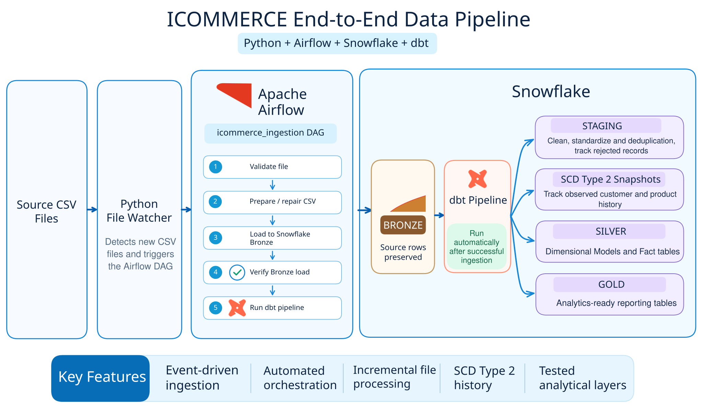

# ICOMMERCE — Event-Driven Sales Data Pipeline

**Python · Apache Airflow · Snowflake · dbt · Docker**

A Data Engineering project that takes sales CSV files from a local folder and turns them into tested analytical tables in Snowflake. I built it to practice the complete workflow: file ingestion, orchestration, data quality, incremental loads, historical tracking, and dimensional modelling.

**In short:** place a CSV in the incoming folder → the Python watcher triggers Airflow → Airflow loads Snowflake Bronze → dbt updates Staging, Silver, and Gold and runs tests. No manual dbt command is needed during normal operation.

## Pipeline Architecture



The Airflow DAG is event-driven (`schedule=None`). A local Python watcher detects new files and submits a DAG run. Airflow verifies ingestion before starting the dbt pipeline, and waits for all seven original datasets before the first dbt run.

| Layer | Responsibility | Main outputs |
| --- | --- | --- |
| **Bronze** | Append source observations and ingestion metadata; preserve source duplicates | `ICOMMERCE.BRONZE.CUSTOMER`, `PRODUCT`, `SALE`, etc. |
| **Staging** | Clean values, convert types, select records, and identify rejected data | `STG_CUSTOMER`, `STG_PRODUCT`, and other dbt views |
| **Silver** | Build reference dimensions, accepted/rejected sales facts, and customer/product history | `DIM_CUSTOMER`, `DIM_PRODUCT`, `FACT_SALE`, `FACT_SALE_REJECTED`, snapshots |
| **Gold** | Expose reporting-oriented fact and dimension tables | `ICOMMERCE.GOLD.FACT_SALE`, `DIM_CUSTOMER`, `DIM_PRODUCT`, `DIM_CALENDAR` |

The Staging models are materialized in `ICOMMERCE.BRONZE`; Silver and Gold are separate Snowflake schemas.

## How the pipeline works

1. **File detection.** `airflow/watch_folder_generic.py` watches `airflow/data/incoming/`. It identifies the dataset from the filename, calculates the file's SHA-256 checksum, keeps a checksum-named copy in `airflow/data/queue/`, and triggers `icommerce_ingestion`.
2. **Bronze ingestion.** The Airflow DAG validates the queued file, normalizes the pipe-delimited CSV, adds `SOURCE_SHA256` and `INGESTED_AT`, then loads the appropriate Bronze table with Snowflake `COPY INTO`. It verifies the loaded row count and timestamp convention.
3. **Initial-load check.** dbt starts only when the seven original source batches are present in Bronze. Later CSV batches can trigger the dbt step after their own successful ingestion.
4. **dbt transformations.** Airflow calls `scripts/run_dbt_pipeline.py`, which runs `dbt deps`, `dbt seed`, Staging models, snapshots, Silver/Gold models, and data tests in that order.
5. **Cleanup.** Temporary prepared files and the Snowflake staged file are removed after success. The queued source CSV is kept for troubleshooting and retries.

Airflow runs in Docker. The file watcher runs on the Windows host, and dbt runs in a separate Python environment inside the Airflow image.

### Input datasets

The pipeline accepts seven source datasets, using the original column layouts defined in `airflow/src/icommerce_ingestion/datasets.py`:

| Dataset | Description | Original batch rows |
| --- | --- | ---: |
| `CATEGORY` | Product categories | 5 |
| `SUB_CATEGORY` | Product subcategories | 18 |
| `TYPE_CUSTOMER` | Customer types | 4 |
| `CUSTOMER` | Customers | 17,545 |
| `PRODUCT` | Products and prices | 3,799 |
| `SALE` | Sales headers | 505 |
| `DETAIL_SALE` | Sales lines | 505 |

These are expected counts for the project's **original source files**, not current warehouse totals. The geographic reference file, `seeds/file_zone_geographique.csv`, is included in the repository and loaded by dbt.

**Source-data requirement:** the seven original sales CSVs are **not included in this repository**. The loader recognizes the initial batches by their SHA-256 checksums; first-time execution requires those unmodified originals. Different files cannot be used as substitutes for the initial load without changing that validation logic. Once the originals are loaded, subsequent batches are treated as incremental observations.

## Key design choices

- **Append-only Bronze.** Source records are not deduplicated in ingestion. This preserves the input observations; dbt handles cleaning and record selection downstream.
- **File-level idempotency.** Before loading, Airflow checks whether all rows with the same `SOURCE_SHA256` are already present. Replaying a completed file does not append it again. The checksum identifies a *file*, not a business record.
- **Customer and product history.** dbt snapshots use the SCD Type 2 `check` strategy to retain observed attribute changes. Later versions are created when tracked values change between dbt runs.
- **Rejected records.** Staging and Silver include rejection models so invalid values or unmatched references can be investigated rather than silently accepted.
- **Sales grain.** The accepted fact is modelled at one product per sale, using `(sale_id, cd_product)` as the source-level combination. `revenue_amount` is calculated as `quantity_sold * sale_price`.
- **Historical assumption.** For sales dated before the first customer/product snapshot, the first observed valid version is used as a baseline. This supports historical joins but does not reconstruct unknown past attributes.

## Run locally

This setup reflects the project as developed: **Windows + Python + Docker Desktop + Snowflake**. The watcher uses local files; it is not a cloud-hosted ingestion service.

### Requirements

- Python 3 and the `watchdog` package on the host
- Docker Desktop with Docker Compose
- A Snowflake account, warehouse, and role permitted to create and access the project objects
- The seven unmodified original CSV files for initial loading

### 1. Clone and prepare

```powershell
git clone https://github.com/saqib-souran/sales-analytics-dbt-snowflake.git
cd sales-analytics-dbt-snowflake
python -m pip install watchdog
```

### 2. Initialize Snowflake

Run `sql/01_create_bronze.sql` in a Snowflake SQL worksheet with a role allowed to create the `ICOMMERCE` database, schemas, Bronze tables, and CSV stage. This script is for a new environment; do **not** truncate existing Bronze tables or delete existing dbt snapshots when rerunning the pipeline.

### 3. Start Airflow

From the repository root:

```powershell
docker compose -f airflow/docker-compose.yaml up -d --build
```

Open [http://localhost:8080](http://localhost:8080) and configure the Airflow Snowflake connection with these values:

| Field | Value |
| --- | --- |
| Connection ID | `snowflake_icommerce` |
| Connection type | Snowflake |
| Login / password | Your Snowflake username and password |
| Extra: `account` | Your Snowflake account identifier |
| Extra: `warehouse` | Your Snowflake warehouse |
| Extra: `role` | Snowflake role, if needed |
| Database / schema | `ICOMMERCE` / `BRONZE` |

The dbt task reuses this Airflow connection and builds a temporary dbt profile from environment variables. The current runner supports **username/password authentication**. Do not commit credentials or a populated `profiles.yml`.

### 4. Start the file watcher

Open a second PowerShell terminal at the repository root:

```powershell
python airflow/watch_folder_generic.py
```

Leave it running to detect incoming CSV files. On the first load, place the seven original files in `airflow/data/incoming/`, using their dataset names (for example, `CATEGORY.csv` and `DETAIL_SALE.csv`). They are submitted to the same DAG; dbt starts when all seven have loaded successfully.

For later batches, use a filename beginning with the dataset name, such as `PRODUCT_update_001.csv`, and retain that dataset's original column names and order. It is safest to copy to a temporary `.part` filename and rename to `.csv` when the copy finishes.

The watcher removes an incoming file after successful **DAG submission**, not after the DAG finishes. Check Airflow for execution success; the queued copy is retained if a run needs investigation.

### 5. Check the results

Open the `icommerce_ingestion` DAG in Airflow. For a completed incremental batch, these tasks should succeed:

```text
check_event → prepare_source → copy_to_original_bronze
            → verify_original_bronze → run_dbt_after_ingestion
            → cleanup_temp_files
```

On a fresh, empty Bronze setup, dbt is skipped until all seven initial datasets are loaded; the seventh successful load triggers it. The `run_dbt_after_ingestion` logs show the dbt commands and test results.

Run `sql/02_verify_bronze.sql` after the original files have loaded to inspect source checksums and row counts. Its `INCREMENTAL_ROWS = 0` expectation applies **before** incremental updates, not after them.

A simple Gold check in Snowflake:

```sql
SELECT
    COUNT(DISTINCT sale_id) AS sales_count,
    COUNT(*) AS sales_lines,
    SUM(quantity_sold) AS units_sold,
    SUM(revenue_amount) AS revenue
FROM ICOMMERCE.GOLD.FACT_SALE;
```

The project does not assign a verified currency to `revenue_amount`.

## Tests

The Python tests cover dataset recognition, CSV preparation (including multiline records), Bronze file generation, checksum/mode validation, and the dbt handoff. Run them without starting Airflow or connecting to Snowflake:

```powershell
python -m unittest discover -s airflow/tests -p "test_*.py" -v
```

When the Airflow dbt task runs, `dbt test` also checks model constraints and SQL assertions, including sales grain, fact references, snapshot validity, classification, and calendar coverage. A passing DAG run means those configured commands completed; it is not a guarantee that every possible source-data issue is covered.

## Repository structure

```text
airflow/
  dags/                       Airflow ingestion DAG
  src/icommerce_ingestion/    Dataset rules, CSV preparation, Bronze loading, dbt handoff
  tests/                      Python unit tests
  watch_folder_generic.py     Local CSV watcher
  Dockerfile                  Airflow + isolated dbt environment
  docker-compose.yaml         Local Airflow service
models/
  staging/                    Cleaning, deduplication, and rejection models
  silver/                     Dimensions, fact tables, and rejected records
  gold/                       Reporting tables
snapshots/                     Customer and product SCD2 history
seeds/                         Geographic reference CSV
scripts/run_dbt_pipeline.py   dbt command sequence executed by Airflow
sql/                           Initial Snowflake setup and verification
tests/                         dbt SQL assertions
dbt_project.yml                dbt project configuration
```

## Scope and limitations

This is a local, portfolio-scale pipeline. Its purpose is to demonstrate the full ingestion-to-analytics workflow, not to claim a production deployment.

- The file watcher must be running on the host; Airflow is triggered by local file events, not by a cloud message broker.
- First-time data loading depends on the original seven CSVs, which are not published here.
- Silver and Gold use table materializations and are rebuilt by the current dbt sequence; snapshots preserve observed history between runs. A larger dataset would benefit from more incremental models.
- Snapshot history starts when the pipeline observes data; it cannot recover changes that occurred before observation.
- The pipeline uses file-level idempotency and selected data-quality checks, not a complete source-to-report reconciliation or exactly-once guarantee across every possible failure.

## Author

**Saqib Souran** — Data Engineering portfolio project  
[GitHub profile](https://github.com/saqib-souran)
